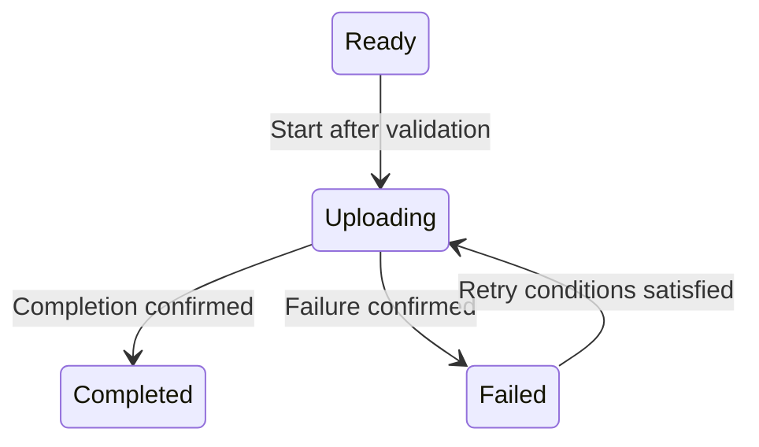

# IMPLICIT_STATES.md

**Make hidden state explicit when working with coding agents.**

An [`AGENTS.md`](https://agents.md/) addendum that gives coding agents a standing practice for discovering implicit state machines, documenting material findings, and checking consequential transitions against current evidence and authority.

The instructions help agents reason about the state already embedded in an application or workflow: scattered flags, files, queues, stages, and ownership conventions. Relevant discoveries go into a maintained `IMPLICIT_STATES.md` registry, or the project's established equivalent, with links to the source and evidence behind them.

**Start here:** [Instructions to add](add-to-your-AGENTS.md) · [Personal configuration example](example.AGENTS.md) · [Quick start](#quick-start)

## What is an implicit state machine?

Imagine a file upload. It can be **ready**, **uploading**, **completed**, or **failed**. There are rules about what can happen next: an upload starts after validation, completion requires confirmation, and a failed attempt may be retried when the retry conditions are satisfied.

Those states and rules form a **state machine**.



*A simplified example. An actual workflow may need additional states, independent dimensions, and recovery rules.*

The machine is **implicit** when its rules exist but are scattered across the code instead of being clearly defined. For example:

```js
const isUploading = false;
const hasUploaded = true;
const hasError = true;
```

Does this mean the upload succeeded but an old error remains on screen? Did a later attempt fail? Are the flags inconsistent? If the answer requires piecing together several callbacks, stored values, and retry paths, the state model is difficult to see and maintain.

Making it explicit means naming the meaningful states, explaining which changes are allowed, and identifying the evidence needed to know what happened. A **transition** changes state. A **guard** is a condition that must hold before that transition is allowed. An **invariant** is a rule that must remain true throughout the workflow.

Booleans can be appropriate. Some state dimensions are independent. The aim is to make their relationships clear and prevent unsupported assumptions about valid combinations.

## Why make this a standing practice?

A discovery prompt can identify hidden state during one review. Adding these instructions to the agent's working guidance makes the same questions relevant during ordinary implementation, debugging, recovery, and handoffs.

The practice asks an agent to:

1. **Start with the affected decision.** Trace the state and material dependencies relevant to the authorized task.
2. **Describe what it finds.** Record the machine, its sources, transition rules, and unresolved questions.
3. **Preserve the discovery.** Update the established registry through its permitted writer when the edit is authorized and in scope.
4. **Check before acting.** Recheck state, dependencies, guards, authority, and required evidence before a consequential transition.
5. **Verify the result.** Establish the post-state from authoritative evidence and leave unconfirmed effects unverified.
6. **Harden when authorized.** Improve source behavior and test the relevant failure and concurrency cases within the task's scope.

Useful applications include authentication and session handling, checkout, multi-step forms, background jobs, caches, installers, deployment workflows, approval processes, and ownership handoffs.

## Repository contents

| File | Purpose |
| --- | --- |
| [README.md](README.md) | Explains the practice, setup, and evidence boundaries. |
| [add-to-your-AGENTS.md](add-to-your-AGENTS.md) | The complete instruction block to incorporate into your agent guidance. |
| [example.AGENTS.md](example.AGENTS.md) | The maintainer's personal `AGENTS.md`, provided as an integration reference. Adapt the relevant parts to your own project. |

The `IMPLICIT_STATES.md` registry described here belongs to **each adopting project**. It records that project's discoveries. This repository supplies the reusable instructions; it does not supply a prepopulated registry for your application.

The instruction block is the reference for the practice. This README explains how to use it. The personal example illustrates one configuration and is optional.

## Quick start

### 1. Add the instructions

Open [add-to-your-AGENTS.md](add-to-your-AGENTS.md) and copy the complete block into the applicable `AGENTS.md` in your project. Incorporate it alongside the project's existing instructions and ownership rules.

No package installation is required. The deliverable is Markdown guidance for an agent that loads it.

### 2. Confirm your agent loads the file

Use the setup guidance below for your agent. File discovery, instruction precedence, and imports depend on the tool and its configuration. The example filename, `example.AGENTS.md`, is intended for reference; put adopted instructions in the file your tool actually loads.

### 3. Apply it during relevant work

Begin with the workflow affected by the current task. Check for an existing registry and existing machine definitions before adding anything.

Create or update a registry entry when there is a material discovery, the edit is authorized and in scope, and you are the permitted writer or are acting through that writer. If those conditions are absent, report the proposed entry or change. A partial entry with clearly identified unknowns is useful; investigate missing details when the authorized task needs them. Do not invent missing transitions or present assumed behavior as an observed fact.

### 4. Add a short repository reference when needed

Once a registry exists, the applicable repository `AGENTS.md` should explain its purpose and when to consult it. Add that reference when the edit is authorized and in scope; otherwise report the proposed addition. For example:

```markdown
## Implicit state registry

Consult `IMPLICIT_STATES.md` when working on the stateful workflows it covers.
Use it to locate authoritative definitions, known gaps, and verification evidence.
Determine current execution state from the linked runtime or task records.
```

Use your established registry path if it has a different name. Keep the inventory in the registry and the pointer in `AGENTS.md` short.

## Agent setup

### Codex

Codex reads `AGENTS.md` through its instruction-file discovery hierarchy. Place the block in the applicable guidance file and account for `AGENTS.override.md` and more local instructions. See OpenAI's [AGENTS.md documentation](https://learn.chatgpt.com/docs/agent-configuration/agents-md) for discovery, precedence, limits, and setup verification.

### Claude Code

Claude Code supports `AGENTS.md`, with automatic loading dependent on its version, settings, and other instruction files. For an explicit import, add this line to a `CLAUDE.md` beside your `AGENTS.md`:

```markdown
@AGENTS.md
```

Keep any Claude-specific guidance alongside the import. Consult the official documentation for [AGENTS.md loading](https://code.claude.com/docs/en/memory#agentsmd) and [sharing one instruction file](https://code.claude.com/docs/en/memory#share-one-file-with-other-coding-tools).

### Other coding agents

Use the tool's documented instruction mechanism to load the block. Check its supported filenames, scope, precedence, and import behavior. The [AGENTS.md project](https://agents.md/) provides information about the format and supporting tools.

## What belongs in the registry?

Use concise notes linked to the relevant source. An entry should make the following understandable, recording unknowns where the evidence is incomplete:

| Area | What to capture |
| --- | --- |
| Identity and scope | A stable machine ID, the affected workflow or decision, and its material dependencies. |
| Authoritative sources | The code, definitions, configuration, and records that establish behavior or execution facts. |
| State dimensions | Meaningful states, independent dimensions, and any constraints on their combinations. |
| Transitions | Triggering events, guards, authorized actors, and intended effects. |
| Invariants and recovery | Rules that must remain true, failure cases, and recovery paths. |
| Evidence and uncertainty | Observed facts, hypotheses, unknowns, and links to existing definitions and tests. |
| Hardening and resolution | What is documented, enforced, and verified; unresolved transitions; deferred risks; and source and verification references retained when an entry is resolved. |

The registry's value comes from accurate, maintained references. Link to authoritative runtime or task records for live execution state rather than copying their changing status into another document.

## Keep four things distinct

| Question | What answers it |
| --- | --- |
| **What is allowed to happen?** | The state model and its transition rules. |
| **What actually happened?** | Authoritative runtime or task records. |
| **What is still uncertain?** | Explicit unknowns, hypotheses, and evidence gaps. |
| **Who may act?** | Applicable instructions, task authority, and established ownership. |

For example, a request log may prove that an upload was attempted. It does not necessarily prove that the server committed the file. A timeout can leave the outcome uncertain. The next consequential action must account for that uncertainty, the workflow's retry rules, and the actor's authority.

**A model describes allowed behavior. Evidence establishes observed behavior. Neither grants permission.**

Apply authority already established for the task. Discovery alone does not authorize remediation. Hold a consequential transition when a material precondition remains unresolved, and verify the resulting state after acting.

## Documented, enforced, and verified

These are separate claims:

| Claim | Meaning |
| --- | --- |
| **Documented** | The states, transitions, and constraints have been described. |
| **Enforced** | The implementation applies the relevant rules. |
| **Verified** | Tests or observations support a stated behavior within an identified scope. |

A written guard does not establish that code enforces it. An enforcement mechanism does not establish that every relevant path has been tested.

When hardening is authorized and in scope, test the relevant **invalid, duplicate, stale, interrupted, and concurrent transitions**. Describe the coverage and remaining gaps accurately. Keep deferred risks visible without adding unrelated refactors.

The addendum supplies instructions for agent behavior. Runtime guarantees require implementation, tests, and operational controls appropriate to the application. Its effectiveness also depends on the agent loading and following the instructions.

## Keep the work proportionate

Discovery follows the authorized task and its material dependencies. Include relevant findings encountered during that task, including findings from completed stages. Leave unrelated completed work outside the investigation.

Use the project's canonical registry. Create entries for materially relevant implicit, uncertain, or weakly enforced machines. A workflow that is already explicit and adequately verified does not need an entry solely for inventory completeness. Create the registry when there is an actual discovery to record; avoid empty or competing inventories, and preserve genuine findings even when they reveal unfinished work.

For new workflows, define consequential states, transitions, guards, and recovery in the appropriate source from the outset. Choose a representation that fits the project: clear data structures, explicit transition functions, or a state-machine library where useful. The practice does not require a particular framework or a single flat list of states.

As findings are resolved, mark their entries accordingly and retain the source and verification references. Future work should be able to see both the discovered risk and the evidence for its resolution.

Report material findings, changes, and unresolved transitions with links to the relevant entries. Reuse those references when the inventory is unchanged.
