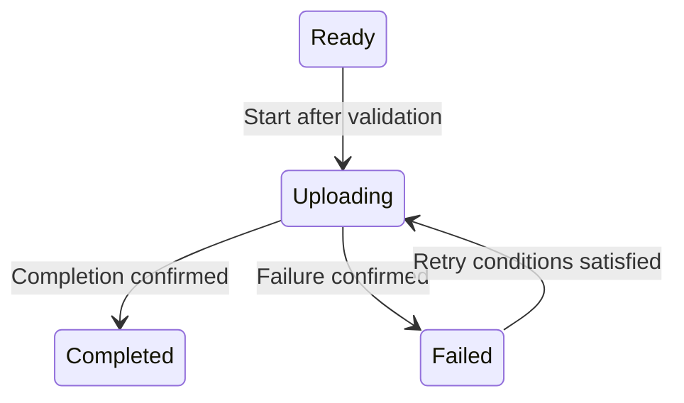

# IMPLICIT_STATES.md

**Make hidden state explicit when working with coding agents.**

An [`AGENTS.md`](https://agents.md/) addendum for coding agents to discover implicit state machines, record material findings, and check consequential transitions against current evidence and authority.

The practice covers state embedded in flags, files, queues, stages, and ownership conventions. Discoveries go into the adopting project's `IMPLICIT_STATES.md` registry, or its established equivalent, with links to authoritative sources and verification evidence.

[Quick start](#quick-start) · [Instruction block](add-to-your-AGENTS.md) · [Personal configuration example](example.AGENTS.md) · [What is an implicit state machine?](#what-is-an-implicit-state-machine)

## What the practice does

A discovery prompt can identify hidden state during one review. Adding the instructions to an agent's working guidance applies the same checks during implementation, debugging, recovery, and handoffs.

The practice asks an agent to:

1. **Start with the affected decision.** Trace the state and material dependencies relevant to the authorized task.
2. **Describe what it finds.** Record the machine, its sources, transition rules, and unresolved questions.
3. **Preserve the discovery.** Update the established registry through its permitted writer when the edit is authorized and in scope.
4. **Check before acting.** Recheck state, dependencies, guards, authority, and required evidence before a consequential transition.
5. **Verify the result.** Establish the post-state from authoritative evidence and leave unconfirmed effects unverified.
6. **Harden when authorized.** Improve source behavior and test the relevant failure and concurrency cases within the task's scope.

Link existing definitions and tests. Partial entries are acceptable. Keep facts, hypotheses, and unknowns distinct; investigate missing details only when the authorized task requires them. Hold a consequential transition if a material precondition remains unresolved.

Applications include authentication and sessions, checkout, multi-step forms, background jobs, caches, installers, deployment workflows, approval processes, and ownership handoffs.

## Quick start

No package installation is required. The addendum is Markdown guidance for an agent that loads and follows it.

1. **Add the instructions.** Copy the complete block from [add-to-your-AGENTS.md](add-to-your-AGENTS.md) into your project's applicable `AGENTS.md`. Incorporate it alongside existing instructions and ownership rules.
2. **Confirm the file loads.** Follow the [agent setup](#agent-setup) guidance for your tool. `example.AGENTS.md` is a reference file; adopted instructions belong in the file your agent actually loads.
3. **Apply it to the current task.** Start with the affected workflow. Check existing definitions and registry entries before adding anything. Create or update an entry for a material discovery only when the edit is authorized, in scope, and made by or through the permitted writer. Otherwise, report the proposed entry or change.
4. **Add a registry reference when needed.** Once a registry exists, the applicable repository `AGENTS.md` should explain its purpose and when to consult it. Add a missing reference only when that edit is authorized and in scope; otherwise report the proposed addition.

For the repository reference, use a short pointer such as:

```markdown
## Implicit state registry

Consult `IMPLICIT_STATES.md` when working on the stateful workflows it covers.
Use it to locate authoritative definitions, known gaps, and verification evidence.
Determine current execution state from the linked runtime or task records.
```

Use the project's established registry path if it differs. Keep the inventory in the registry, not in `AGENTS.md`.

## What is an implicit state machine?

Imagine a file upload. It can be **ready**, **uploading**, **completed**, or **failed**. Rules determine what can happen next: validation permits an upload to start, confirmation establishes completion, and a failed attempt can be retried when its retry conditions hold.

These states and rules form a **state machine**.



*This is a simplified example. An actual workflow may need additional states, independent dimensions, and recovery rules.*

The machine is **implicit** when its rules are scattered across the code instead of clearly defined. For example:

```js
const isUploading = false;
const hasUploaded = true;
const hasError = true;
```

These flags alone do not tell you whether an upload succeeded with an old error still displayed, a later attempt failed, or the combination is inconsistent. Answering that question may require tracing several callbacks, stored values, and retry paths.

Making the machine explicit means naming its meaningful states, defining allowed changes, and identifying the evidence needed to establish what happened. A **transition** changes state. A **guard** is a condition that must hold before a transition is allowed. An **invariant** is a rule that must remain true throughout the workflow.

Booleans can be appropriate, and some state dimensions are independent. The aim is to clarify their relationships and the constraints on valid combinations.

## Repository contents

| File | Purpose |
| --- | --- |
| [README.md](README.md) | Explains the practice, adoption steps, and evidence boundaries. |
| [add-to-your-AGENTS.md](add-to-your-AGENTS.md) | Contains the complete instruction block to incorporate into agent guidance. |
| [example.AGENTS.md](example.AGENTS.md) | Shows the maintainer's personal configuration as an optional integration reference. Adapt the relevant parts to your project. |

The instruction block defines the practice; this README explains its use. The personal example is optional.

The `IMPLICIT_STATES.md` registry belongs to **each adopting project** and records that project's discoveries. This repository provides reusable instructions, not a prepopulated registry for your application.

## Agent setup

File discovery, precedence, and imports depend on the agent and its configuration. Confirm that the adopted instructions load in the context where the agent will work.

### Codex

Codex reads `AGENTS.md` through an instruction-file hierarchy. Put the block in the applicable guidance file and account for `AGENTS.override.md` and more local instructions. OpenAI's [AGENTS.md documentation](https://learn.chatgpt.com/docs/agent-configuration/agents-md) describes discovery, precedence, limits, and setup verification.

### Claude Code

Claude Code supports `AGENTS.md`, but automatic loading depends on its version, settings, and other instruction files. To import it explicitly, add this line to a `CLAUDE.md` beside your `AGENTS.md`:

```markdown
@AGENTS.md
```

Keep any Claude-specific guidance alongside the import. The official documentation explains [AGENTS.md loading](https://code.claude.com/docs/en/memory#agentsmd) and [sharing one instruction file](https://code.claude.com/docs/en/memory#share-one-file-with-other-coding-tools).

### Other coding agents

Load the block through the tool's documented instruction mechanism. Check supported filenames, scope, precedence, and import behavior. The [AGENTS.md project](https://agents.md/) describes the format and supporting tools.

## What belongs in the registry?

Write concise, source-linked entries. Record unknowns where evidence is incomplete; do not invent missing transitions or describe assumptions as observed facts.

| Area | What to capture |
| --- | --- |
| Identity and scope | A stable machine ID, the affected workflow or decision, and material dependencies. |
| Authoritative sources | Code, definitions, configuration, and records that establish behavior or execution facts. |
| State dimensions | Meaningful states, independent dimensions, and constraints on their combinations. |
| Transitions | Triggering events, guards, authorized actors, and intended effects. |
| Invariants and recovery | Rules that must remain true, failure cases, and recovery paths. |
| Evidence and uncertainty | Observed facts, hypotheses, unknowns, and links to existing definitions and tests. |
| Hardening and resolution | What is documented, enforced, and verified; unresolved transitions; deferred risks; and source and verification references retained after resolution. |

Link to authoritative runtime or task records for current execution state. Do not duplicate their changing status in the registry.

## Keep four things distinct

| Question | Source of the answer |
| --- | --- |
| **What transitions does the model allow?** | The state model and its transition rules. |
| **What actually happened?** | Authoritative runtime or task records. |
| **What remains uncertain?** | Explicit unknowns, hypotheses, and evidence gaps. |
| **Who may act?** | Applicable instructions, task authority, and established ownership. |

For example, a request log may establish that an upload was attempted without proving that the server committed the file. A timeout can leave the outcome uncertain. Any next consequential action must account for that uncertainty, the retry rules, and the actor's authority.

A model describes allowed behavior; evidence establishes observed behavior. Neither grants permission. Apply authority already established for the task. Identifying a problem does not authorize remediation.

## Documented, enforced, and verified

| Claim | Meaning |
| --- | --- |
| **Documented** | The states, transitions, and constraints have been described. |
| **Enforced** | The implementation applies the relevant rules. |
| **Verified** | Tests or observations support a stated behavior within an identified scope. |

A written guard does not establish that code enforces it. An enforcement mechanism does not establish that every relevant path has been tested.

When hardening is authorized and in scope, test relevant **invalid, duplicate, stale, interrupted, and concurrent transitions**. State the coverage and remaining gaps. Document deferred risks without unrelated refactors.

The addendum guides agent behavior. Runtime guarantees require implementation, tests, and operational controls appropriate to the application. The practice also depends on the agent loading and following the instructions.

## Keep the work proportionate

Follow the authorized task and its material dependencies. Include relevant discoveries encountered during the task, including those from completed stages. Do not inspect unrelated completed work solely to populate the registry.

Use the project's canonical registry for materially relevant implicit, uncertain, or weakly enforced machines. Workflows that are already explicit and adequately verified do not need entries solely for inventory completeness. Create a registry when there is an actual discovery to record. Avoid empty or competing inventories, and do not conceal genuine findings to make the inventory appear empty.

For new workflows, define consequential states, transitions, guards, and recovery in the appropriate source from the outset. Use a representation that fits the project: clear data structures, explicit transition functions, or a state-machine library where useful. The practice requires neither a particular framework nor a single flat list of states.

Mark resolved entries and retain their source and verification references so later work can trace the finding and its resolution. Report material findings, changes, and unresolved transitions with links to the relevant entries instead of repeating an unchanged inventory.
